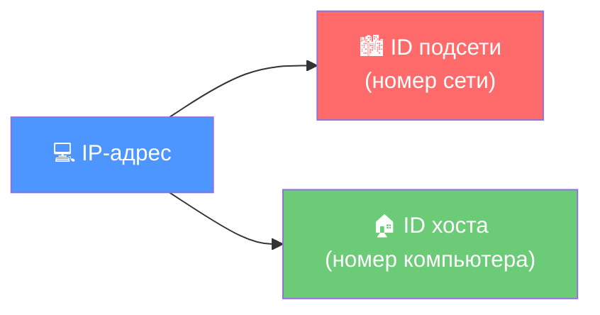
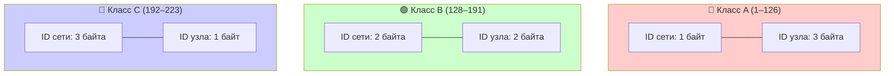

# УРОК 5. IP-АДРЕСАЦИЯ. КЛАССЫ И МАСКИ

| **Предыдущее занятие** | | **Следующее занятие** |
|:---:|:---:|:---:|
| [Урок 4. Модель OSI и стек TCP/IP](../lesson_04/lecture_04.md) | [Содержание](../README.md) | [Урок 6. Коммутаторы и концентраторы](../lesson_06/lecture_06.md) |

---

**👨‍🏫 Преподаватель:** Сафиулин Р.Р.  
**📚 Дисциплина:** ОП.11 Компьютерные сети  
**📅 Семестр:** 1  
**⏱️ Время занятия:** 90 минут (45 + 45)

---

# 📑 Оглавление

**📝 Часть 1. Самостоятельная работа (45 минут)**
1. [📋 Инструкция для студентов](#-часть-1-инструкция-для-студентов)
2. [📝 Варианты самостоятельной работы](#-варианты-самостоятельной-работы)
3. [📊 Критерии оценивания](#-критерии-оценивания)

**📖 Часть 2. Лекция (45 минут)**
4. [🎯 Цели урока](#-цели-урока)
5. [📖 Что такое IP-адрес?](#-1-что-такое-ip-адрес)
6. [📖 Структура IP-адреса](#-2-структура-ip-адреса)
7. [📖 Классы IP-адресов](#-3-классы-ip-адресов)
8. [📖 Маска подсети](#-4-маска-подсети)
9. [📖 Особые IP-адреса](#-5-особые-ip-адреса)
10. [📖 CIDR и бесклассовая адресация](#-6-cidr-и-бесклассовая-адресация)
11. [📖 Как определить номер сети и номер узла](#-7-как-определить-номер-сети-и-номер-узла)
12. [📖 IPv6 — будущее адресации](#-8-ipv6--будущее-адресации)
13. [🖥️ Практическое задание](#️-практическое-задание-на-занятии-510-минут)
14. [📝 Домашнее задание](#-домашнее-задание)
15. [🔗 Ссылки для студентов](#-ссылки-для-студентов)

---

# 📝 ЧАСТЬ 1. САМОСТОЯТЕЛЬНАЯ РАБОТА (45 МИНУТ)

## 📋 Инструкция для студентов

> ⚠️ **Внимание!** Перед вами самостоятельная работа по итогам уроков 1–4.

1. 📌 Перед вами **5 вариантов** самостоятельной работы.
2. 📌 Каждый вариант содержит **5 вопросов**, требующих **развёрнутого ответа**.
3. 📌 Выберите **один вариант** (по указанию преподавателя).
4. 📌 На каждый вопрос отвечайте **развёрнуто**: 2–5 предложений с примерами.
5. ⏱️ **Время выполнения:** 45 минут.
6. 🚫 **Пользоваться конспектами и интернетом запрещено.**

---

## 📝 Варианты самостоятельной работы

### 🔵 ВАРИАНТ 1

**1.** Дайте определение компьютерной сети. Назовите три типа сетей по размеру и приведите примеры каждого типа.

**2.** Объясните, чем отличается топология «шина» от топологии «звезда». Назовите по два преимущества и два недостатка каждой.

**3.** Что такое витая пара? Почему проводники в ней скручены между собой? Назовите две категории витой пары и скорости передачи для них.

**4.** Объясните, зачем нужна модель OSI. Назовите все семь уровней модели OSI (сверху вниз) и кратко опишите, за что отвечает каждый.

**5.** Сравните протоколы TCP и UDP. Назовите не менее трёх отличий и приведите примеры использования каждого.

---

### 🟢 ВАРИАНТ 2

**1.** Назовите три главных преимущества компьютерных сетей и три главных недостатка. Приведите примеры из жизни.

**2.** Объясните, что такое коллизия. В какой топологии она возможна и почему? Как решается проблема коллизий в современных сетях?

**3.** Что такое коммутатор и чем он отличается от концентратора? Назовите минимум три отличия. Почему концентраторы практически вышли из употребления?

**4.** Объясните, что такое инкапсуляция данных. Опишите, какие заголовки добавляются на каждом уровне модели TCP/IP при отправке сообщения.

**5.** На каком уровне модели OSI работает коммутатор, а на каком — маршрутизатор? Объясните, почему так, и приведите примеры задач каждого устройства.

---

### 🟡 ВАРИАНТ 3

**1.** Расшифруйте аббревиатуры: LAN, WAN, MAN, PAN. Приведите пример сети каждого типа из своей повседневной жизни.

**2.** Объясните, что такое клиент-серверная архитектура. Приведите три примера из жизни, указав, кто является клиентом, а кто — сервером.

**3.** Что такое маркировка кабеля витая пара? Расшифруйте маркировку: `F/UTP SOLID 4P CATEGORY 6 23AWG LSZH`. Ответьте: экранированный ли кабель, какая категория, где его можно прокладывать?

**4.** Сравните модель OSI и стек TCP/IP. Назовите не менее трёх отличий. Объясните, почему TCP/IP используется в реальных сетях, а OSI — нет.

**5.** Объясните разницу между прямым и перекрёстным кабелем. Для чего используется каждый из них? Почему в современных сетях перекрёстный кабель почти не нужен?

---

### 🟠 ВАРИАНТ 4

**1.** Назовите четыре этапа развития компьютерных сетей. Кратко опишите каждый этап и приведите пример технологии того времени.

**2.** Объясните, почему топология «кольцо» может иметь большую суммарную длину, чем «шина» и «звезда». Что такое репитер и зачем он нужен?

**3.** Что такое оптоволоконный кабель? Назовите два типа оптоволокна и укажите их различия (диаметр сердцевины, дальность, применение).

**4.** Что такое PDU? Назовите PDU для каждого уровня стека TCP/IP и объясните, что добавляется на каждом уровне.

**5.** Объясните, что такое IP-адрес и MAC-адрес. На каком уровне модели OSI работает каждый из них? Чем они отличаются?

---

### 🔴 ВАРИАНТ 5

**1.** Кто изобрёл Интернет и WWW? Объясните разницу между этими понятиями. Приведите даты и имена изобретателей.

**2.** Объясните, что такое топология «Mesh» (сеточная). Чем отличается полная сеточная топология от частичной? Где применяется каждая из них?

**3.** Что такое витая пара? Назовите четыре типа экранирования (UTP, STP, FTP, S/FTP) и объясните, чем они отличаются. Какой тип используется в 90% сетей и почему?

**4.** Назовите четыре уровня стека TCP/IP и объясните, за что отвечает каждый. Приведите примеры протоколов для каждого уровня.

**5.** Объясните, как данные путешествуют от вашего компьютера к веб-серверу. Опишите пошагово, что происходит на каждом уровне модели TCP/IP.

---

## 📊 Критерии оценивания

| ✅ Количество правильных развёрнутых ответов | 🏆 Оценка |
|:---:|:---:|
| **5** | **Отлично (5)** ⭐⭐⭐⭐⭐ |
| **4** | **Хорошо (4)** ⭐⭐⭐⭐ |
| **3** | **Удовлетворительно (3)** ⭐⭐⭐ |
| **2 и менее** | **Неудовлетворительно (2)** ⭐⭐ |

### 💡 Дополнительные требования:

- ✅ Ответ **засчитывается**, если студент раскрыл суть вопроса, привёл пример и показал понимание темы.
- ❌ Ответ **не засчитывается**, если студент написал одно слово, не раскрыл тему или допустил грубые фактические ошибки.
- 🎁 За **дополнительный пример** из жизни или **схему** — дополнительный балл.

---

# 📖 ЧАСТЬ 2. ЛЕКЦИЯ (45 МИНУТ)

## 🎯 Цели урока

После изучения этого урока вы сможете:

1. ✅ Объяснить, что такое IP-адрес и зачем он нужен
2. ✅ Определить структуру IP-адреса (номер сети + номер узла)
3. ✅ Назвать классы IP-адресов (A, B, C, D, E) и их диапазоны
4. ✅ Объяснить, что такое маска подсети и как она работает
5. ✅ Определить номер сети и номер узла с помощью маски
6. ✅ Расшифровать запись CIDR (например, `192.168.1.1/24`)
7. ✅ Назвать особые IP-адреса (loopback, broadcast, subnet ID)
8. ✅ Рассчитать количество узлов в сети по маске
9. ✅ Понять, чем отличается IPv4 от IPv6

---

## 📖 1. Что такое IP-адрес?

**IP-адрес** (Internet Protocol address) — это **уникальный цифровой адрес** устройства в сети, который используется для его идентификации и передачи данных.

> 💡 **Простыми словами:** IP-адрес — это «почтовый адрес» компьютера в сети. Как у каждого дома есть адрес, так у каждого устройства в сети есть IP-адрес.

### 🎯 Зачем нужен IP-адрес?

| 🎯 Задача | 💡 Как решается с помощью IP-адреса |
|:---|:---|
| **Идентификация** | Каждое устройство в сети имеет уникальный адрес |
| **Маршрутизация** | Маршрутизаторы знают, куда отправлять пакеты |
| **Доставка данных** | Данные попадают именно тому устройству, которому адресованы |
| **Разделение сетей** | IP-адрес содержит информацию о том, в какой сети находится устройство |

### 📬 Аналогия

```
┌─────────────────────────────────────────────────────────────┐
│              📬 IP-АДРЕС = ПОЧТОВЫЙ АДРЕС                     │
├─────────────────────────────────────────────────────────────┤
│                                                             │
│  📮 Почтовый адрес:                                         │
│  г. Москва, ул. Ленина, д. 10, кв. 5                        │
│  └─город─┘ └───улица───┘ └─дом─┘ └кв.┘                      │
│                                                             │
│  💻 IP-адрес:                                                │
│  192.168.1.100                                              │
│  └──сеть──┘ └─узел─┘                                        │
│                                                             │
│  🏙️ Первая часть — номер сети (в каком «городе»)            │
│  🏠 Вторая часть — номер узла (какой «дом»)                 │
│                                                             │
└─────────────────────────────────────────────────────────────┘
```

---

## 📖 2. Структура IP-адреса

### 🔢 Формат записи IPv4

IP-адрес версии 4 (IPv4) состоит из **32 бит** (4 байта), которые записываются в виде **четырёх десятичных чисел**, разделённых точками.

```
┌─────────────────────────────────────────────────────────────┐
│                 🔢 СТРУКТУРА IP-АДРЕСА                        │
├─────────────────────────────────────────────────────────────┤
│                                                             │
│  📟 Двоичная запись (32 бита):                              │
│  11000000.10101000.00000001.01100100                        │
│                                                             │
│  🔢 Десятичная запись (4 октета):                            │
│  192      .168      .1        .100                          │
│  └──октет──┘└──октет──┘└──октет──┘└──октет──┘              │
│                                                             │
└─────────────────────────────────────────────────────────────┘
```

### 📏 Каждый октет — от 0 до 255

| 🔢 Октет | 📊 Диапазон | 💡 Пример |
|:---:|:---:|:---:|
| 1 | 0–255 | 192 |
| 2 | 0–255 | 168 |
| 3 | 0–255 | 1 |
| 4 | 0–255 | 100 |

**Максимальное значение октета:** 255 (двоичное `11111111`).

> ⚠️ **Важно:** IP-адреса, в которых хотя бы один октет превышает 255, являются **недействительными**.
>
> ✅ `172.16.123.1` — действительный
> ❌ `172.16.123.256` — несуществующий (256 > 255)

### 🏗️ Две части IP-адреса



| 🧩 Часть | 💡 Что означает | 📌 Пример |
|:---|:---|:---|
| **ID подсети** | Номер сети, в которой находится устройство | 192.168.1 |
| **ID хоста** | Номер устройства внутри этой сети | 100 |

**📌 Пример:** `192.168.1.100`
- Если первые **3 байта** — номер сети: `192.168.1.0`
- Последний **1 байт** — номер узла: `0.0.0.100`

---

## 📖 3. Классы IP-адресов

Исторически IP-адреса делятся на **классы** в зависимости от того, сколько байт отводится под номер сети и сколько — под номер узла.

### 📊 Таблица классов IP-адресов

| 🎯 Класс | 🔢 Первые биты | 📉 Наименьший номер сети | 📈 Наибольший номер сети | 🌐 Кол-во сетей | 💻 Макс. узлов |
|:---:|:---:|:---|:---|:---:|:---:|
| **A** | `0` | 1.0.0.0 | 126.0.0.0 | 126 | 2²⁴ − 2 = **16 777 214** |
| **B** | `10` | 128.0.0.0 | 191.255.0.0 | 16 384 | 2¹⁶ − 2 = **65 534** |
| **C** | `110` | 192.0.1.0 | 223.255.255.0 | 2 097 152 | 2⁸ − 2 = **254** |
| **D** | `1110` | 224.0.0.0 | 239.255.255.255 | — | 🎯 Multicast |
| **E** | `11110` | 240.0.0.0 | 247.255.255.255 | — | 🔒 Зарезервирован |

### 📐 Схема классов



### 🔍 Как определить класс по первому октету?

| 📊 Первый октет | 🎯 Класс | 💡 Пример |
|:---:|:---:|:---|
| **1–126** | A | 10.0.0.1 |
| **127** | 🔄 Loopback | 127.0.0.1 |
| **128–191** | B | 172.16.0.1 |
| **192–223** | C | 192.168.1.1 |
| **224–239** | D (multicast) | 224.0.0.1 |
| **240–255** | E (зарезервирован) | 240.0.0.1 |

> 💡 **Запомните:** Для повседневной работы важны классы **A, B и C**. Классы D и E — специальные.

### 📌 Примеры адресов разных классов

| 🎯 Класс | 💻 Пример IP | 🏙️ Номер сети | 🏠 Номер узла |
|:---:|:---|:---|:---|
| **A** | `17.239.47.94` | `17.0.0.0` | `0.239.47.94` |
| **B** | `172.16.123.1` | `172.16.0.0` | `0.0.123.1` |
| **C** | `192.168.1.100` | `192.168.1.0` | `0.0.0.100` |

---

## 📖 4. Маска подсети

**Маска подсети** (subnet mask) — это число, которое используется **в паре с IP-адресом** и определяет, какая часть IP-адреса является **номером сети**, а какая — **номером узла**.

### ⚙️ Как работает маска?

Маска — это **32-битное число**, в котором:
- **Единицы (1)** — соответствуют битам **номера сети**
- **Нули (0)** — соответствуют битам **номера узла**

```
┌─────────────────────────────────────────────────────────────┐
│                 🎭 МАСКА ПОДСЕТИ                              │
├─────────────────────────────────────────────────────────────┤
│                                                             │
│  💻 IP-адрес:  11000000.10101000.00000001.01100100          │
│  🎭 Маска:     11111111.11111111.11111111.00000000          │
│                └───────────сеть───────────┘└──узел──┘       │
│                                                             │
│  🔢 Маска в десятичном виде: 255.255.255.0                  │
│                                                             │
└─────────────────────────────────────────────────────────────┘
```

### 📐 Стандартные маски для классов

| 🎯 Класс | 📟 Маска (двоичная) | 🔢 Маска (десятичная) | 📏 Префикс |
|:---:|:---|:---|:---:|
| **A** | `11111111.00000000.00000000.00000000` | 255.0.0.0 | /8 |
| **B** | `11111111.11111111.00000000.00000000` | 255.255.0.0 | /16 |
| **C** | `11111111.11111111.11111111.00000000` | 255.255.255.0 | /24 |

### ✍️ Формат записи маски

Маску можно записать двумя способами:

| 📝 Способ | 💡 Пример | 📖 Расшифровка |
|:---|:---|:---|
| **Десятичный** | `255.255.255.0` | 24 единицы, 8 нулей |
| **CIDR (префикс)** | `192.168.1.1/24` | 24 единицы в маске |

> 💡 **Запомните:** `/24` означает, что в маске **24 единицы** (то есть `255.255.255.0`).

### ⚠️ Правило маски

Маска в двоичном виде **всегда** имеет структуру: **все единицы, потом все нули**.

```
✅ Правильно:  11111111.11111111.11111111.00000000  (255.255.255.0)
✅ Правильно:  11111111.11111111.11000000.00000000  (255.255.192.0)
❌ Неправильно: 11111111.11110111.00000000.00001000  (255.247.0.8)
```

**🚫 Разрывы в последовательности единиц или нулей недопустимы!**

### 📊 Возможные значения последнего октета маски

| 📟 Двоичное | 🔢 Десятичное | 📏 CIDR |
|:---:|:---:|:---:|
| `11111110` | 254 | /31 |
| `11111100` | 252 | /30 |
| `11111000` | 248 | /29 |
| `11110000` | 240 | /28 |
| `11100000` | 224 | /27 |
| `11000000` | 192 | /26 |
| `10000000` | 128 | /25 |
| `00000000` | 0 | /24 |

---

## 📖 5. Особые IP-адреса

Некоторые IP-адреса **не могут использоваться** для идентификации обычных устройств. Их называют **особыми**.

| 🎯 Адрес | 📛 Название | 💡 Что означает |
|:---|:---|:---|
| **127.x.x.x** | 🔄 Loopback | «Петля» — адрес самого устройства. Используется для проверки работы TCP/IP |
| **0.0.0.0** | 📤 Узел-отправитель | Обозначает «этот узел» |
| **255.255.255.255** | 📢 Ограниченный broadcast | Пакет отправляется всем узлам в подсети |
| **x.x.x.255** (для /24) | 📢 Broadcast | Пакет отправляется всем узлам подсети |
| **x.x.x.0** (для /24) | 🏙️ Subnet ID | Идентификатор самой подсети |

### ❓ Почему в сети класса C — 254 узла, а не 256?

В сети класса C последний байт может принимать значения от 0 до 255 — это **256 адресов**. Но два из них **зарезервированы**:

- `x.x.x.0` — **номер сети** (subnet ID)
- `x.x.x.255` — **broadcast** (широковещательный адрес)

**✅ Итого:** 256 − 2 = **254 адреса** для узлов.

### 🧮 Формула количества узлов

Если под номер узла отводится **N бит**, то количество узлов:

\[
2^N - 2
\]

> 💡 **Пример:** Если N = 8 (последний байт), то 2⁸ − 2 = 256 − 2 = **254 узла**.

---

## 📖 6. CIDR и бесклассовая адресация

### 📜 Классовая адресация (устаревшая)

**Классовая IP-адресация** — метод, при котором класс сети определяется по первым битам, и используется **фиксированная маска** для каждого класса.

⚠️ **Проблема:** нерациональное использование адресов. Например, если организации нужен 1 адрес, ей всё равно выделяют целую сеть класса C (254 адреса).

### 🚀 Бесклассовая адресация (CIDR)

**CIDR** (Classless Inter-Domain Routing) — метод, при котором можно использовать **маски переменной длины** (VLSM).

✅ **Преимущество:** можно выделить ровно столько адресов, сколько нужно.

### 📊 Сравнение

| 📜 Классовая | 🚀 Бесклассовая (CIDR) |
|:---|:---|
| Фиксированная маска | Переменная маска |
| Неэффективно | ✅ Эффективно |
| Класс определяется по первым битам | Класс не важен |

> 💡 **Пример CIDR:** `192.168.1.0/26` — сеть на 62 узла (2⁶ − 2).

---

## 📖 7. Как определить номер сети и номер узла

### 🔧 Алгоритм определения

1. 📟 Перевести IP-адрес и маску в **двоичный вид**.
2. 🔗 Выполнить операцию **AND** (логическое умножение) между IP-адресом и маской.
3. 🏙️ Результат — **номер сети** (ID подсети).
4. 🏠 Для получения **номера узла** — обнулить биты, соответствующие номеру сети.

### 🔗 Операция AND

| A | B | A AND B |
|:---:|:---:|:---:|
| 0 | 0 | 0 |
| 0 | 1 | 0 |
| 1 | 0 | 0 |
| 1 | 1 | ✅ 1 |

### 📌 Пример 1: `17.239.47.94/16`

**Шаг 1. Двоичная запись:**

```
💻 IP:   00010001.11101111.00101111.01011110
🎭 Маска: 11111111.11111111.00000000.00000000
```

**Шаг 2. Операция AND:**

```
  00010001.11101111.00101111.01011110
& 11111111.11111111.00000000.00000000
  ─────────────────────────────────────
  00010001.11101111.00000000.00000000
```

**Шаг 3. Результат:**

| 🎯 Параметр | 📊 Значение |
|:---|:---|
| **🏙️ ID подсети** | 17.239.0.0 |
| **🏠 ID узла** | 0.0.47.94 |

### 📌 Пример 2: `192.168.89.16/18`

**Шаг 1. Двоичная запись:**

```
💻 IP:   11000000.10101000.01011001.00010000
🎭 Маска: 11111111.11111111.11000000.00000000
```

**Шаг 2. Операция AND:**

```
  11000000.10101000.01011001.00010000
& 11111111.11111111.11000000.00000000
  ─────────────────────────────────────
  11000000.10101000.01000000.00000000
```

**Шаг 3. Результат:**

| 🎯 Параметр | 📊 Значение |
|:---|:---|
| **🏙️ ID подсети** | 192.168.64.0 |
| **🏠 ID узла** | 0.0.25.16 |

### 📌 Пример 3: `192.168.104.151/27`

**Шаг 1. Маска /27:**

```
11111111.11111111.11111111.11100000 = 255.255.255.224
```

**Шаг 2. Двоичная запись IP:**

```
192.168.104.151 = 11000000.10101000.01101000.10010111
```

**Шаг 3. AND:**

```
  11000000.10101000.01101000.10010111
& 11111111.11111111.11111111.11100000
  ─────────────────────────────────────
  11000000.10101000.01101000.10000000 = 192.168.104.128
```

**Результат:**

| 🎯 Параметр | 📊 Значение |
|:---|:---|
| **🏙️ ID подсети** | 192.168.104.128 |
| **🏠 ID узла** | 0.0.0.23 |

---

## 📖 8. IPv6 — будущее адресации

### ⚠️ Проблема IPv4

IPv4 использует **32-битные** адреса — это около **4,3 миллиарда** уникальных адресов. Этого уже не хватает: в мире больше устройств, чем адресов.

### 🚀 Решение — IPv6

**IPv6** — версия IP с **128-битными** адресами. Это обеспечивает **огромное** адресное пространство.

| 📊 Характеристика | 📜 IPv4 | 🚀 IPv6 |
|:---|:---:|:---:|
| **📏 Длина адреса** | 32 бита | 128 бит |
| **🌐 Количество адресов** | ~4,3 млрд | ~340 ундециллионов |
| **✍️ Формат записи** | 192.168.1.1 | 2001:0db8:85a3::8a2e:0370:7334 |
| **⚙️ Автоконфигурация** | DHCP | ✅ Встроенная |
| **🔒 Безопасность** | Опционально (IPsec) | ✅ Обязательно (IPsec) |

### ✨ Особенности IPv6

- ⚙️ **Автоматическая конфигурация** — устройство само настраивает адрес
- 🔒 **Встроенная безопасность** — обязательное использование IPsec
- 📦 **Упрощённый заголовок** — быстрее обработка
- 📢 **Поддержка multicast** — эффективная групповая рассылка

---

## 🖥️ Практическое задание (на занятии, 5–10 минут)

**✍️ Выполните в тетради:**

### 📝 Задание 1. Определите класс IP-адреса

| 💻 IP-адрес | 🎯 Класс | 🏙️ Номер сети | 🏠 Номер узла |
|:---|:---:|:---|:---|
| `10.40.45.48` | ? | ? | ? |
| `172.16.123.1` | ? | ? | ? |
| `192.168.1.100` | ? | ? | ? |
| `127.0.0.1` | ? | ? | ? |
| `224.0.0.1` | ? | ? | ? |

### 📝 Задание 2. Определите номер сети и номер узла

| 💻 IP-адрес / маска | 🏙️ ID подсети | 🏠 ID узла |
|:---|:---|:---|
| `192.168.104.151 / 255.255.255.224` | ? | ? |
| `172.16.12.12 / 255.255.255.248` | ? | ? |
| `10.40.15.15 / 255.255.255.224` | ? | ? |

### 📝 Задание 3. Сколько узлов в сети?

| 💻 IP-адрес | 🎭 Маска | 💻 Количество узлов |
|:---|:---|:---:|
| `192.168.104.109/25` | ? | ? |
| `192.168.104.109/30` | ? | ? |
| `172.16.12.12/29` | ? | ? |

### 📝 Задание 4. В одной ли подсети?

Определите, находятся ли два узла в одной подсети:

| 💻 Компьютер А | 💻 Компьютер В | 🎭 Маска | ✅ В одной подсети? |
|:---|:---|:---|:---:|
| `94.235.16.59` | `94.235.23.240` | `255.255.240.0` | ? |
| `131.189.15.6` | `131.173.216.56` | `255.248.0.0` | ? |

---

## 📝 Домашнее задание

**📄 Оформите в Microsoft Word (или Google Docs) и загрузите в Google Форму по ссылке от преподавателя.**

**📁 Название файла:** `Фамилия_Имя_Урок05.docx`

### 📚 Часть 1. Ответьте на вопросы (письменно)

1. Что такое IP-адрес? Зачем он нужен?
2. Из скольких бит состоит IPv4-адрес? Как он записывается?
3. Назовите три класса IP-адресов (A, B, C) и укажите их диапазоны.
4. Что такое маска подсети? Как она работает?
5. Как записать маску `255.255.255.0` в формате CIDR?
6. Что такое особые IP-адреса? Назовите три примера.
7. Почему в сети класса C — 254 узла, а не 256?
8. Что такое CIDR? Чем он отличается от классовой адресации?
9. Чем отличается IPv4 от IPv6? Назовите минимум 3 отличия.
10. Как определить номер сети и номер узла с помощью маски?

### 🧮 Часть 2. Практическая задача

**📌 Задача 1.** Дан IP-адрес `192.168.89.16` и маска `255.255.192.0`. Определите:
- Класс адреса
- ID подсети
- ID узла

**📌 Задача 2.** Дан IP-адрес `172.16.12.12/29`. Определите:
- Маску в десятичном виде
- Количество узлов в сети
- ID подсети

**📌 Задача 3.** Определите, находятся ли два узла в одной подсети:
- Компьютер А: `215.125.159.36`
- Компьютер В: `215.125.153.56`
- Маска: `255.255.224.0`

### 🎨 Часть 3. Схема (по желанию, для дополнительного балла)

Нарисуйте схему деления сети класса B `160.95.0.0/16` на **3 подсети** с маской `255.255.255.0`. Укажите:
- Адреса подсетей
- Количество узлов в каждой
- Как маршрутизатор будет переправлять пакеты

### 💭 Часть 4. Рефлексия (по желанию)

Напишите 3-5 предложений:
- Что нового вы узнали из этого урока?
- Что было самым сложным?
- Есть ли вопросы, которые остались непонятными?

---

## 🔗 Ссылки для студентов

- 📝 **Google Форма для ДЗ:** [255 группа](https://forms.gle/9cNj9WnYqab3CXfk8) [257 группа](https://forms.gle/XhrGHZW8JB1Jtn9T9)
- 🧪 **Google Форма для теста:** [255 группа](https://forms.gle/dcsdUh8RG9kWMSpz5) [257 группа](https://forms.gle/YgLq7Z4Zi7Q69Pk36)

---

| **Предыдущее занятие** | | **Следующее занятие** |
|:---:|:---:|:---:|
| [Урок 4. Модель OSI и стек TCP/IP](../lesson_04/lecture_04.md) | [Содержание](../README.md) | [Урок 6. Коммутаторы и концентраторы](../lesson_06/lecture_06.md) |
