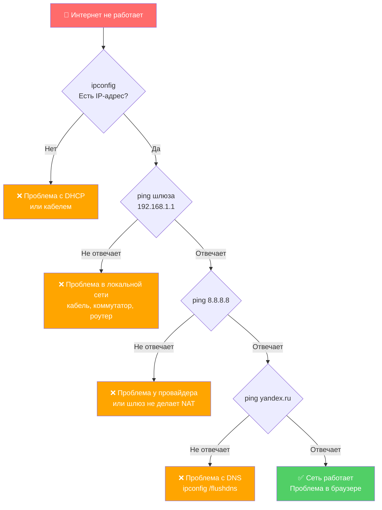
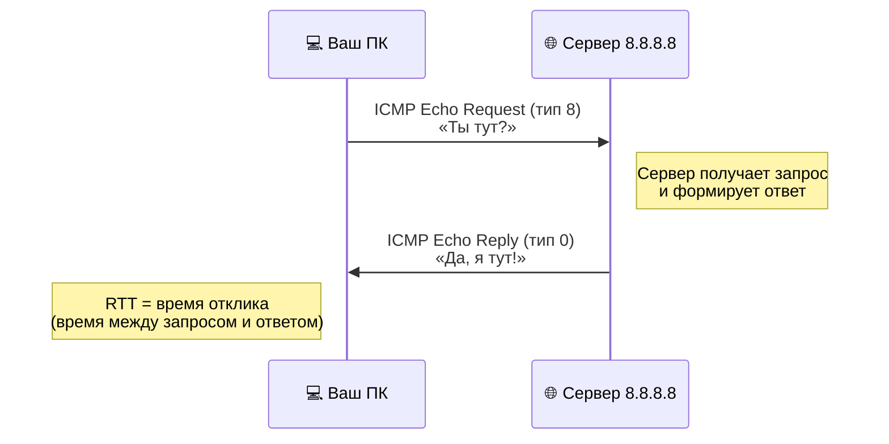
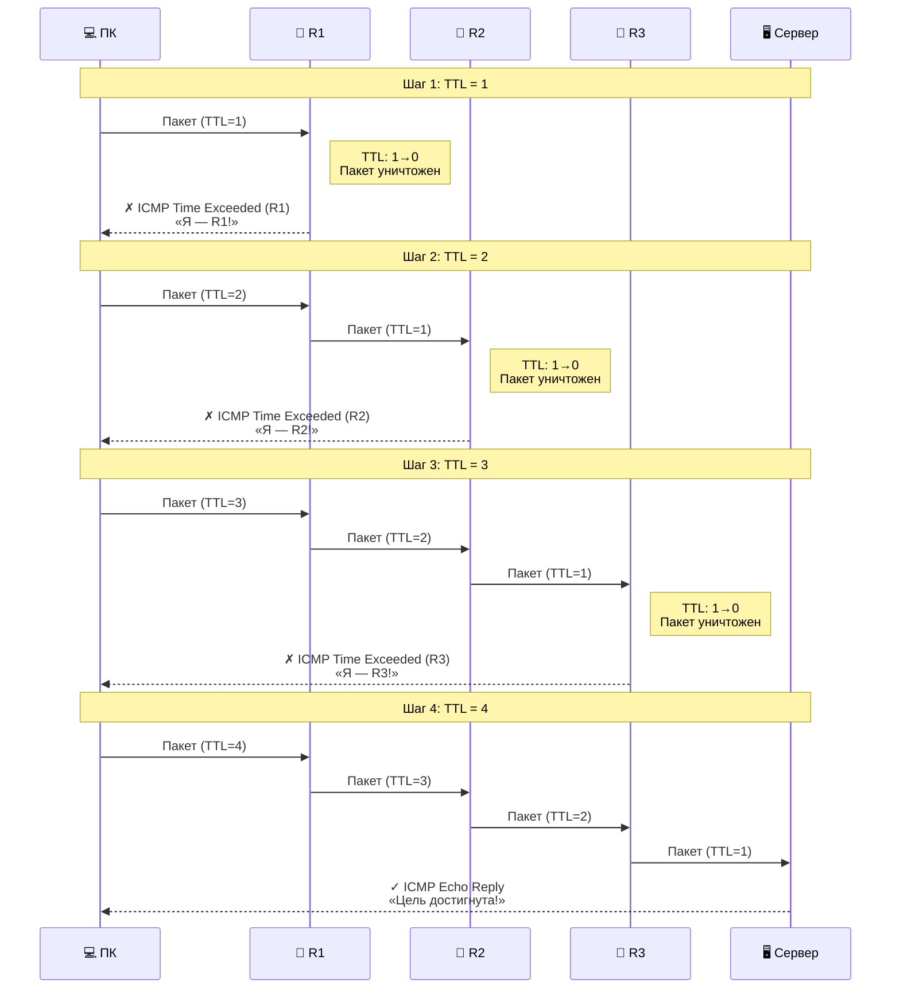
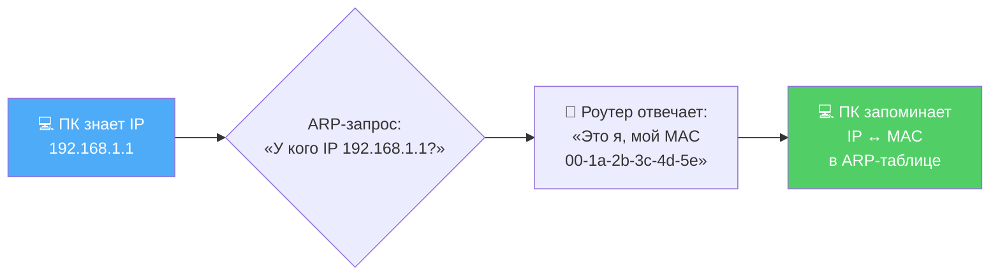

# УРОК 6. СЕТЕВЫЕ УТИЛИТЫ ДИАГНОСТИКИ TCP/IP

| **Предыдущее занятие** | | **Следующее занятие** |
|:---:|:---:|:---:|
| [Урок 5. Модель OSI и стек TCP/IP](../lesson_05/lecture_05.md) | [Содержание](../README.md) | [Урок 7. Коммутаторы и концентраторы](../lesson_07/lecture_07.md) |


**Преподаватель:** Сафиулин Р.Р.
**Дисциплина:** ОП.11 Компьютерные сети
**Семестр:** 1
**⏱️ Время занятия:** 90 минут (45 + 45)

---

# 📑 Оглавление

**📖 Часть 1. Теория (60 минут)**

1. [🎯 Цели урока](#-цели-урока)
2. [📖 Что такое диагностика сети и зачем она нужна](#-1-что-такое-диагностика-сети-и-зачем-она-нужна)
3. [📖 ipconfig — просмотр конфигурации в Windows](#-2-ipconfig--просмотр-конфигурации-в-windows)
4. [📖 ip a и ifconfig — просмотр конфигурации в Linux](#-3-ip-a-и-ifconfig--просмотр-конфигурации-в-linux)
5. [📖 ping — проверка доступности узла](#-4-ping--проверка-доступности-узла)
6. [📖 Как работает ping: протокол ICMP](#-5-как-работает-ping-протокол-icmp)
7. [📖 Ключи ping в Windows и Linux](#-6-ключи-ping-в-windows-и-linux)
8. [📖 Трассировка маршрута — что это такое и зачем нужна](#-7-трассировка-маршрута--что-это-такое-и-зачем-нужна)
9. [📖 Как работает трассировка: магия TTL](#-8-как-работает-трассировка-магия-ttl)
10. [📖 tracert — трассировка в Windows](#-9-tracert--трассировка-в-windows)
11. [📖 traceroute и tracepath — трассировка в Linux](#-10-traceroute-и-tracepath--трассировка-в-linux)
12. [📖 netstat — анализ соединений в Windows](#-11-netstat--анализ-соединений-в-windows)
13. [📖 ss — анализ соединений в Linux](#-12-ss--анализ-соединений-в-linux)
14. [📖 arp — таблица соответствия IP ↔ MAC](#-13-arp--таблица-соответствия-ip--mac)
15. [📖 hostname — имя компьютера](#-14-hostname--имя-компьютера)
16. [📖 Сводная таблица: Windows ↔ Linux](#-15-сводная-таблица-windows--linux)

**🖥️ Часть 2. Практика (30 минут)**

17. [🖥️ Практическое задание](#️-практическое-задание)
18. [📝 Домашнее задание](#-домашнее-задание)

**🔗 Часть 3. Ссылки**

19. [🔗 Ссылки для студентов](#-ссылки-для-студентов)
---

## 🎯 Цели урока

После изучения этого урока вы сможете:

- Объяснить, что такое диагностика сети и зачем она нужна
- Пользоваться `ipconfig` в Windows и `ip a` в Linux
- Понимать, как работает `ping` на уровне протокола ICMP
- Объяснить, что такое трассировка маршрута и как работает TTL
- Пользоваться `tracert` в Windows и `traceroute`/`tracepath` в Linux
- Анализировать сетевые соединения через `netstat` и `ss`
- Работать с ARP-таблицей
- Назвать различия в синтаксисе утилит Windows и Linux

---

## 📖 1. Что такое диагностика сети и зачем она нужна

Представьте: вы открываете браузер, вводите `yandex.ru` — и ничего не происходит. Страница не загружается. Что случилось?

Возможных причин **десятки**:

- Кабель не подключён
- Сетевой адаптер выключен
- Не настроен IP-адрес
- Неправильная маска подсети
- Не указан шлюз по умолчанию
- Шлюз не отвечает
- DNS-сервер не работает
- Маршрутизатор посередине сети сломался
- Провайдер отключил интернет
- Сайт действительно недоступен

**Как найти причину?** Методом тыка — долго и ненадёжно. Нужен инструмент, который покажет, **где именно** обрывается связь.

💡 **Аналогия:** представьте, что вы звоните другу, но он не берёт трубку. Вы можете:

- Проверить, что телефон включён (`ipconfig`)
- Позвонить и послушать гудки (`ping`)
- Проверить, работает ли АТС (`tracert`)
- Посмотреть, какие звонки сейчас идут (`netstat`)

**Сетевые утилиты** — это и есть такие «проверочные звонки» для сети.

### 🔍 Схема диагностики: где искать проблему



**Вывод:** диагностика идёт **от простого к сложному** — сначала проверяем свой ПК, потом шлюз, потом интернет, потом DNS. Каждый шаг отсекает часть причин.

### Что такое утилиты диагностики TCP/IP

**Утилиты диагностики TCP/IP** — это встроенные программы, которые позволяют:

| 🎯 Задача | 🔧 Что показывает |
|-----------|------------------|
| Посмотреть настройки сети | IP, маска, шлюз, DNS, MAC |
| Проверить доступность устройства | Отвечает ли узел на запросы |
| Проследить путь пакетов | Через какие маршрутизаторы идёт трафик |
| Посмотреть соединения | Кто с кем и по какому порту общается |
| Узнать MAC по IP | Соответствие IP ↔ MAC в локальной сети |

Они есть **в любой ОС** — Windows, Linux, macOS. Не нужно ничего устанавливать. Открыл терминал — проверил.

⚠️ **Важно:** в Windows и Linux одни и те же задачи решаются **разными командами**. Это как с языками: «спасибо» по-русски и «thank you» по-английски — смысл один, слова разные.

---

## 📖 2. `ipconfig` — просмотр конфигурации в Windows

**Что делает:** показывает текущие настройки сетевого адаптера — IP-адрес, маску подсети, шлюз по умолчанию, MAC-адрес, DNS-серверы.

### 🔑 Ключи

| 🔧 Ключ | 💡 Что делает |
|---------|--------------|
| `ipconfig` | Базовая информация: IP, маска, шлюз |
| `ipconfig /all` | Полная информация: + MAC, DHCP, DNS |
| `ipconfig /release` | Освободить IP-адрес (DHCP) |
| `ipconfig /renew` | Запросить новый IP-адрес |
| `ipconfig /flushdns` | Очистить кэш DNS |
| `ipconfig /displaydns` | Показать содержимое DNS-кэша |

### 📌 Пример `ipconfig`

```
Адаптер Ethernet:
   IPv4-адрес. . . . . . . . . . . . : 192.168.1.100
   Маска подсети. . . . . . . . . . . : 255.255.255.0
   Основной шлюз. . . . . . . . . . . : 192.168.1.1
```

**Что это значит:**

- **IP-адрес `192.168.1.100`** — адрес вашего компьютера в сети
- **Маска `255.255.255.0`** — говорит, что первые три числа — номер сети, последнее — номер узла
- **Шлюз `192.168.1.1`** — адрес маршрутизатора, через который вы выходите в другие сети (в интернет)

### 📌 Пример `ipconfig /all`

```
Адаптер Ethernet:
   Физический адрес. . . . . . . . . : 00-1A-2B-3C-4D-5E
   DHCP включён. . . . . . . . . . . : Да
   IPv4-адрес. . . . . . . . . . . . : 192.168.1.100
   Маска подсети. . . . . . . . . . . : 255.255.255.0
   Основной шлюз. . . . . . . . . . . : 192.168.1.1
   DNS-серверы. . . . . . . . . . . . : 8.8.8.8, 8.8.4.4
```

**Что добавилось:**

- **Физический адрес (MAC)** — уникальный адрес сетевой карты, «паспорт» устройства
- **DHCP включён** — IP-адрес выдан автоматически сервером DHCP, а не задан вручную
- **DNS-серверы** — адреса серверов, которые переводят имена (`yandex.ru`) в IP-адреса

---

## 📖 3. `ip a` и `ifconfig` — просмотр конфигурации в Linux

В Linux исторически использовался `ifconfig`, но он **устарел**. Современный стандарт — команда `ip` из пакета `iproute2`.

### 🔑 Команды

| 🔧 Команда | 💡 Что делает |
|-----------|--------------|
| `ip a` | Все интерфейсы и IP-адреса |
| `ip a show eth0` | Информация о конкретном интерфейсе |
| `ip -4 a` | Только IPv4-адреса |
| `ip -s a` | Статистика по интерфейсам |
| `ip route` | Таблица маршрутизации (аналог шлюза) |

### 📌 Пример `ip a`

```
2: eth0: <BROADCAST,MULTICAST,UP,LOWER_UP> mtu 1500
    link/ether 00:1a:2b:3c:4d:5e brd ff:ff:ff:ff:ff:ff
    inet 192.168.1.100/24 brd 192.168.1.255 scope global eth0
```

**Что это значит:**

- `eth0` — имя сетевого интерфейса
- `link/ether 00:1a:2b:3c:4d:5e` — MAC-адрес
- `inet 192.168.1.100/24` — IP-адрес с маской `/24` (= 255.255.255.0)
- `UP` — интерфейс включён

⚠️ **Важно:** в старых дистрибутивах Linux `ifconfig` может отсутствовать. Если он нужен — установите пакет `net-tools`: `sudo apt install net-tools`.

---

## 📖 4. `ping` — проверка доступности узла

**`ping`** — утилита, которая проверяет, отвечает ли удалённое устройство. Она отправляет специальный пакет и ждёт ответа.

💡 **Аналогия:** вы кричите в пещеру «Эхо!» и слушаете, вернётся ли «Эхо!». Если вернулось — пещера есть, связь работает. Если нет — либо пещера далеко, либо её нет, либо что-то заглушает.

### 📖 Как работает `ping`: протокол ICMP

`ping` использует **ICMP** (Internet Control Message Protocol) — протокол управляющих сообщений.



**Пошагово:**

1. `ping` формирует ICMP-пакет с типом **8** (Echo Request)
2. Пакет уходит на указанный IP-адрес
3. Если узел доступен и не блокирует ICMP — он отвечает пакетом с типом **0** (Echo Reply)
4. `ping` замеряет время между отправкой и получением — это **время отклика (RTT, Round-Trip Time)**

### 📖 Ключи `ping` в Windows и Linux

| 🔧 Задача | 🪟 Windows | 🐧 Linux |
|-----------|-----------|---------|
| Количество запросов | `-n 5` | `-c 5` |
| Размер пакета | `-l 1000` | `-s 1000` |
| Непрерывно | `-t` | (по умолчанию непрерывно) |
| Таймаут | `-w 1000` | `-W 1` (секунды) |
| Интервал между пакетами | — | `-i 0.5` |

### 📌 Пример успешного `ping`

```
C:\>ping 8.8.8.8

Обмен пакетами с 8.8.8.8 по с 32 байтами данных:
Ответ от 8.8.8.8: число байт=32 время=15мс TTL=118
Ответ от 8.8.8.8: число байт=32 время=14мс TTL=118
Ответ от 8.8.8.8: число байт=32 время=15мс TTL=118
Ответ от 8.8.8.8: число байт=32 время=15мс TTL=118

Статистика Ping для 8.8.8.8:
    Пакетов: отправлено = 4, получено = 4, потеряно = 0 (0% потерь)
```

**Что это значит:**

- **`число байт=32`** — размер пакета
- **`время=15мс`** — время отклика (RTT)
- **`TTL=118`** — Time To Live (сколько «прыжков» пакет может сделать)
- **`потеряно = 0`** — все пакеты дошли

### 📌 Пример неудачного `ping`

```
C:\>ping 192.168.0.3
Ответ от 192.168.1.1: Заданный узел недоступен.
```

**Что это значит:** ваш шлюз (`192.168.1.1`) сообщает, что не знает, как доставить пакет до `192.168.0.3`. Скорее всего, узел выключен или не в той подсети.

⚠️ **Важно:** отсутствие ответа ≠ узел выключен. Многие серверы блокируют ICMP из соображений безопасности. Если `ping` не проходит — это не значит, что узел недоступен.

---

## 📖 5. Трассировка маршрута — что это такое и зачем нужна

**Трассировка маршрута** — это определение пути, по которому пакеты идут от вашего компьютера до целевого узла, со списком всех промежуточных маршрутизаторов.

💡 **Аналогия:** вы едете из Москвы во Владивосток. Вы можете:

- Просто доехать (как `ping` — «я доехал?»)
- **Записать все города, через которые проезжали** (как `tracert` — «через какие города я ехал?»)

**Трассировка** показывает каждый маршрутизатор (хоп) на пути: от вашего шлюза → до маршрутизатора провайдера → до магистрального оператора → до сервера назначения.

### 🗺️ Пример сети: что видит трассировка


**Трассировка покажет все 4 хопа** — от вашего ПК до сервера. Именно это и есть «путь пакета».

### 📖 Зачем это нужно

| 🎯 Задача | 💡 Как помогает трассировка |
|-----------|---------------------------|
| Найти, где обрыв | Если ping не проходит — трассировка покажет, на каком хопе пакеты перестают возвращаться |
| Оценить качество | Видно, на каком участке большие задержки (например, 200 мс на 3-м хопе) |
| Проверить маршрут | Убедиться, что трафик идёт через нужного провайдера, а не через «заграницу» |
| Диагностика провайдера | Показать провайдеру: «смотрите, на вашем 5-м маршрутизаторе потери» |

---

## 📖 6. Как работает трассировка: магия TTL

Это самая важная часть — понять, **как** трассировка узнаёт адреса промежуточных маршрутизаторов.

### 📖 Что такое TTL

**TTL (Time To Live)** — это поле в IP-заголовке, которое показывает, сколько «прыжков» (хопов) пакет может сделать, прежде чем будет уничтожен.

**Зачем нужно TTL?** Чтобы пакеты не бродили по сети вечно, если в маршрутизации ошибка (петля). Каждый маршрутизатор, через который проходит пакет, **уменьшает TTL на 1**. Если TTL стал равен 0 — маршрутизатор уничтожает пакет и отправляет отправителю сообщение **ICMP Time Exceeded** («время истекло»).

### 🎬 Пошаговая работа трассировки



**Вот почему трассировка работает:** она постепенно увеличивает TTL и заставляет каждый маршрутизатор «представиться», когда TTL истекает.

⚠️ **Важно:** не все маршрутизаторы отвечают на ICMP. Некоторые блокируют такие сообщения. Тогда на месте хопа вы увидите `* * *` (таймаут) — это нормально.

---

## 📖 7. `tracert` — трассировка в Windows

### 🔑 Ключи

| 🔧 Ключ | 💡 Что делает |
|---------|--------------|
| `tracert A.B.C.D` | Трассировка до узла |
| `tracert -h 5 A.B.C.D` | Максимум 5 хопов |
| `tracert -w 1000 A.B.C.D` | Таймаут 1000 мс |
| `tracert -d A.B.C.D` | Не разрешать имена (быстрее) |

### 📌 Пример

```
C:\>tracert -d yandex.ru

Трассировка маршрута к yandex.ru [77.88.55.88]
с максимальным числом прыжков 30:

  1    <1 мс    <1 мс    <1 мс   192.168.1.1
  2     5 мс     4 мс     5 мс   10.10.0.1
  3    15 мс    14 мс    15 мс   213.180.193.1
  4    16 мс    15 мс    16 мс   77.88.55.88

Трассировка завершена.
```

**Что это значит:**

- **4 хопа** до Яндекса
- **Хоп 1** — ваш домашний маршрутизатор (`192.168.1.1`)
- **Хоп 2** — маршрутизатор провайдера (`10.10.0.1`)
- **Хоп 3** — магистральный маршрутизатор (`213.180.193.1`)
- **Хоп 4** — сервер Яндекса (`77.88.55.88`)

---

## 📖 8. `traceroute` и `tracepath` — трассировка в Linux

В Linux есть **две** утилиты:

| 🔧 Утилита | 💡 Особенность |
|-----------|--------------|
| `traceroute` | Классическая, на многих дистрибутивах требует root |
| `tracepath` | Современная, **не требует root**, измеряет MTU |

### 📌 Пример `traceroute`

```bash
$ traceroute -n 8.8.8.8
traceroute to 8.8.8.8, 30 hops max, 60 byte packets
 1  192.168.1.1     1.234 ms
 2  10.10.0.1       5.432 ms
 3  213.180.193.1  15.123 ms
 4  8.8.8.8        16.456 ms
```

### 📌 Пример `tracepath`

```bash
$ tracepath -n 8.8.8.8
 1:  192.168.1.1     0.123ms
 2:  10.10.0.1       5.432ms
 3:  213.180.193.1  15.123ms
 4:  8.8.8.8        16.456ms
```

⚠️ **Ключи `tracepath`:** `-n` (без имён), `-m N` (максимум хопов), `-l SIZE` (размер пакета).

---

## 📖 9. `netstat` — анализ соединений в Windows

**`netstat`** показывает активные сетевые соединения, прослушиваемые порты и статистику.

💡 **Аналогия:** это как список всех телефонных звонков в офисе: кто кому звонит, на какой номер, сколько длится.

### 🔑 Ключи

| 🔧 Ключ | 💡 Что делает |
|---------|--------------|
| `netstat -a` | Все подключения и порты |
| `netstat -n` | Числовой вид (без имён) |
| `netstat -s` | Статистика по протоколам |
| `netstat -e` | Статистика по Ethernet |
| `netstat -ano` | + PID процесса |

### 📌 Пример `netstat -ano`

```
Активные подключения
  Имя    Локальный адрес        Внешний адрес          Состояние     PID
  TCP    192.168.1.100:49152    8.8.8.8:443            ESTABLISHED   1234
  TCP    192.168.1.100:49153    93.158.134.3:443       ESTABLISHED   5678
```

**Что это значит:**

- `192.168.1.100:49152` — ваш IP и порт
- `8.8.8.8:443` — удалённый IP и порт (443 = HTTPS)
- `ESTABLISHED` — соединение установлено
- `PID 1234` — процесс, который держит соединение

---

## 📖 10. `ss` — анализ соединений в Linux

В Linux `netstat` **устарел**. Современная замена — **`ss`** (Socket Statistics). Она работает **быстрее**, потому что получает информацию напрямую из ядра.

| 🔧 Задача | 🐧 `ss` | 🐧 `netstat` (устаревший) |
|-----------|--------|--------------------------|
| TCP-соединения | `ss -t` | `netstat -t` |
| Прослушиваемые порты | `ss -tlnp` | `netstat -tlnp` |
| UDP-порты | `ss -ulnp` | `netstat -ulnp` |
| Все соединения | `ss -tunlp` | `netstat -tunlp` |
| Статистика | `ss -s` | `netstat -s` |

**Ключи `ss`:** `-t` (TCP), `-u` (UDP), `-l` (только listening), `-n` (числовой вид), `-p` (процесс).

### 📌 Пример `ss -tlnp`

```
State    Recv-Q  Send-Q  Local Address:Port  Process
LISTEN   0       128     0.0.0.0:22          users:(("sshd",pid=1234))
LISTEN   0       128     0.0.0.0:80          users:(("nginx",pid=5678))
```

**Что это значит:**

- Порт `22` слушает `sshd` (SSH-сервер)
- Порт `80` слушает `nginx` (веб-сервер)

---

## 📖 11. `arp` — таблица соответствия IP ↔ MAC

**ARP (Address Resolution Protocol)** — протокол, который определяет MAC-адрес по известному IP.

💡 **Аналогия:** вы знаете адрес дома (IP), но вам нужен номер квартиры (MAC), чтобы доставить письмо. ARP — это «справочная», которая подсказывает номер квартиры.



### 🔑 Ключи

| 🔧 Ключ | 💡 Что делает |
|---------|--------------|
| `arp -a` | Показать всю ARP-таблицу |
| `arp -s IP MAC` | Добавить статическую запись |
| `arp -d IP` | Удалить запись |

### 📌 Пример в Windows

```cmd
C:\>arp -a

Интерфейс: 192.168.1.100 --- 0x5
  Интернет-адрес      Физический адрес      Тип
  192.168.1.1         00-1a-2b-3c-4d-5e     динамический
  192.168.1.3         00-1a-2b-3c-4d-6f     динамический
```

### 📌 Пример в Linux

```bash
$ arp -a
? (192.168.1.1) at 00:1a:2b:3c:4d:5e [ether] on eth0

$ ip neighbor
192.168.1.1 dev eth0 lladdr 00:1a:2b:3c:4d:5e REACHABLE
```

---

## 📖 12. `hostname` — имя компьютера

```cmd
C:\>hostname
PC-01
```

```bash
$ hostname
linux-pc
```

---

## 📖 13. Сводная таблица: Windows ↔ Linux

| 🔧 Задача | 🪟 Windows | 🐧 Linux (современный) | 🐧 Linux (устаревший) |
|-----------|-----------|----------------------|---------------------|
| Просмотр IP | `ipconfig` | `ip a` | `ifconfig` |
| Полная конфигурация | `ipconfig /all` | `ip -s a` | `ifconfig -a` |
| Проверка связи | `ping -n 5` | `ping -c 5` | `ping -c 5` |
| Размер пакета | `ping -l 1000` | `ping -s 1000` | `ping -s 1000` |
| Трассировка | `tracert` | `traceroute -n` / `tracepath -n` | `traceroute` |
| Соединения | `netstat -ano` | `ss -tunlp` | `netstat -tunlp` |
| ARP-таблица | `arp -a` | `ip neighbor` | `arp -a` |
| Имя хоста | `hostname` | `hostname` | `hostname` |

---

## 🖥️ Практическое задание (выполняется на занятии)

### Задание 1. Windows

Откройте командную строку (`Win+R` → `cmd`) и выполните:

| № | Команда | Записать в тетрадь |
|---|---------|-------------------|
| 1 | `ipconfig` | IP, маска, шлюз |
| 2 | `ipconfig /all` | MAC, DHCP, DNS |
| 3 | `ping -n 5 8.8.8.8` | Успешно? Потери? |
| 4 | `ping -l 1000 -n 3 google.com` | Размер пакета |
| 5 | `tracert -d -h 10 yandex.ru` | Первые 5 хопов |
| 6 | `netstat -ano` | Активные соединения |
| 7 | `arp -a` | IP ↔ MAC |
| 8 | `hostname` | Имя ПК |

### Задание 2. Linux (если есть доступ)

| № | Команда | Записать в тетрадь |
|---|---------|-------------------|
| 1 | `ip a` | IP, MAC, состояние |
| 2 | `ip -4 a` | Только IPv4 |
| 3 | `ping -c 5 8.8.8.8` | Успешно? Потери? |
| 4 | `ping -s 1000 -c 3 google.com` | Размер пакета |
| 5 | `tracepath -n 8.8.8.8` | Хопы (без root) |
| 6 | `ss -tlnp` | Прослушиваемые порты |
| 7 | `ip neighbor` | ARP-таблица |
| 8 | `hostname` | Имя хоста |

### Задание 3. Сравнение

Заполните таблицу:

| Задача | Windows | Linux |
|--------|---------|-------|
| Узнать IP | | |
| Проверить связь (5 пакетов) | | |
| Трассировка (без имён) | | |
| Прослушиваемые порты | | |

### Задание 4. Анализ `ping`

Выполните `ping -n 5 8.8.8.8`. Ответьте:

- Сколько пакетов отправлено?
- Сколько получено?
- Какое среднее время отклика?
- Чему равен TTL? Что это значит?

### Задание 5. Анализ трассировки

Выполните `tracert -d -h 10 yandex.ru`. Ответьте:

- Сколько хопов до цели?
- Какой хоп — ваш домашний маршрутизатор?
- Какой хоп — маршрутизатор провайдера?
- Есть ли хопы с большими задержками?

### Задание 6. Обсуждение в группе

Обсудите с соседом по парте:

- Почему `ping` может не проходить, хотя узел работает?
- Почему трассировка иногда показывает `* * *` на некоторых хопах?
- Зачем нужна трассировка, если есть `ping`?

---

## 📝 Домашнее задание

Оформите в Microsoft Word (или Google Docs) и загрузите в Google Форму по ссылке от преподавателя.

**Название файла:** `Фамилия_Имя_Урок06.docx`

### Часть 1. Ответьте на вопросы (письменно)

1. Зачем нужны сетевые утилиты? Приведите 3 примера ситуаций, когда они помогают.
2. Чем `ipconfig` отличается от `ipconfig /all`?
3. Какая команда в Linux заменяет `ipconfig`? Почему `ifconfig` считается устаревшим?
4. Как с помощью `ping` проверить доступность узла? На что смотреть в ответе?
5. Какой протокол использует `ping`? Какие типы сообщений он отправляет?
6. Что такое TTL? Как он используется в трассировке маршрута?
7. Объясните пошагово, как `tracert` узнаёт адреса промежуточных маршрутизаторов.
8. Чем `traceroute` отличается от `tracepath`? Когда что использовать?
9. Чем `netstat -a` отличается от `netstat -n`?
10. Какая команда в Linux заменяет `netstat`? Почему она быстрее?
11. Что такое ARP? Как посмотреть ARP-таблицу в Windows? А в Linux?
12. Какая команда выводит имя компьютера?

### Часть 2. Сравнительная таблица

Заполните таблицу:

| Характеристика | Windows | Linux (современный) | Linux (устаревший) |
|---------------|---------|--------------------|--------------------|
| Просмотр IP | | | |
| Проверка связи | | | |
| Трассировка | | | |
| Соединения | | | |
| ARP-таблица | | | |

### Часть 3. Практическая задача

**Задача 1.** Выполните `ipconfig /all` в Windows. Выпишите: IP, маску, шлюз, MAC, DNS, статус DHCP.

**Задача 2.** Выполните `ping -n 5 8.8.8.8` и `ping -n 5 yandex.ru`. Сравните результаты. Объясните, почему один может работать, а другой — нет.

**Задача 3.** Выполните `tracert -d -h 10 yandex.ru`. Запишите первые 5 хопов. Объясните, что означает каждый.

**Задача 4.** (Для тех, у кого есть Linux) Выполните `ss -tlnp` и `ip neighbor`. Сравните с `netstat -ano` и `arp -a` в Windows.

### Часть 4. Схема

**Нарисуйте схему: «Как работает трассировка маршрута»:**

- Ваш ПК → R1 → R2 → R3 → Сервер
- Покажите, какие пакеты отправляются с TTL=1, TTL=2, TTL=3, TTL=4
- Покажите, где пакет уничтожается и кто отправляет ICMP Time Exceeded
- Подпишите, какой маршрутизатор «раскрывается» на каждом шаге

Как выполнить:

- Можно нарисовать от руки и сфотографировать
- Можно нарисовать в любом редакторе (Paint, Word, онлайн-редактор)

### Часть 5. Рефлексия (по желанию, для дополнительного балла)

Напишите 3–5 предложений:

- Что нового вы узнали из этого урока?
- Что было самым сложным?
- Есть ли вопросы, которые остались непонятными?

---

## 🔗 Ссылки для студентов

| 📚 Материал | 🔗 Ссылка |
|------------|----------|
| Google Форма для ДЗ | 255 группа / 257 группа |
| Google Форма для теста | 255 группа / 257 группа |
| Шпаргалка по командам Linux | Смотреть (из материалов семестра) |

